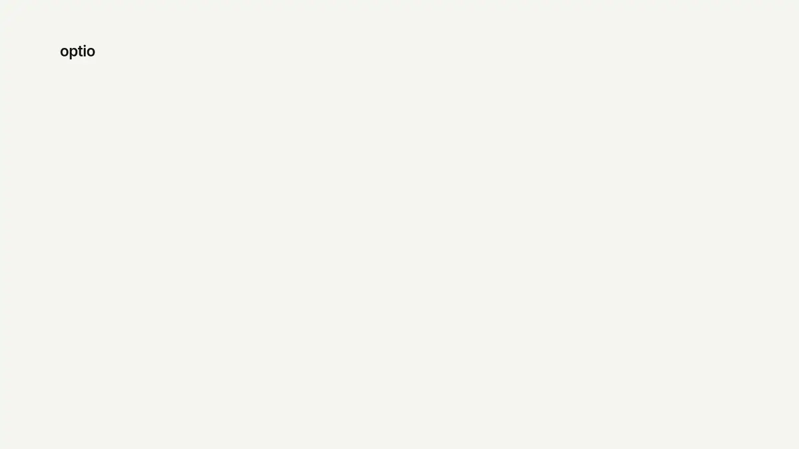

# optio

**See where your time goes.** Optio is a free, open-source time and motion
study app that runs in your browser: on a phone on the shop floor, a tablet on
a ward round or a laptop at your desk.

<picture>
  <source media="(prefers-reduced-motion: reduce)" srcset="docs/images/promo-still.webp" />
  
</picture>

### [Open Optio →](https://mariusom.github.io/optio/)

No account, no install, no server. Add it to your home screen and it works
offline after the first visit.

## How it works

1. **Set up.** Pick a template of questions (station, task type, tools used…)
   or build your own with single and multiple choice, yes/no, numbers, counters,
   ratings and text.
2. **Observe.** Tap what you see and record each task. A running timer, large
   touch targets and a “Larger controls” mode keep it quick, even with gloves.
   Every answer is saved as you go.
3. **Review.** Each session breaks down task time by answer, so you can see how
   much went to value-added work, walking or waiting. Templates add up every
   session recorded with them. Export everything as CSV.

## Why Optio

- **Private by default.** Studies stay in your browser. Nothing is uploaded.
- **Built for the floor.** Phone-first, offline, keyboard-friendly and
  accessible. Every look is checked against WCAG 2.2 AA in light and dark.
- **Your style.** Five looks (Swiss, Classic, Studio, Shopfloor, Blueprint),
  accent colours, fonts and dark mode.
- **Works with AI, if you want it.** Plan a template in any chat with the
  [agent guide](https://mariusom.github.io/optio/agent-guide.md), or give an
  in-tab assistant consent-gated access through WebMCP. It's off by default;
  read [agent access](docs/agent-access.md) before enabling it.

## Good to know

Studies have no automatic backup or sync, and clearing site data can erase
them. Download a backup from Settings (it restores on any device) or export
CSV.

This is a pre-release. The current storage revision starts fresh; earlier
pre-release studies are not migrated, so export anything you want to keep from
an old build before updating.

## Contributing

Optio began as a Swift time-study app and is now an Effect UI web app.
Start with [contributing](CONTRIBUTING.md), then [development](docs/development.md),
[architecture](docs/architecture.md) and [interface conventions](docs/interface.md).

[MIT license](LICENSE) · [Third-party notices](https://mariusom.github.io/optio/THIRD_PARTY_NOTICES.txt) ·
[Security](SECURITY.md)
